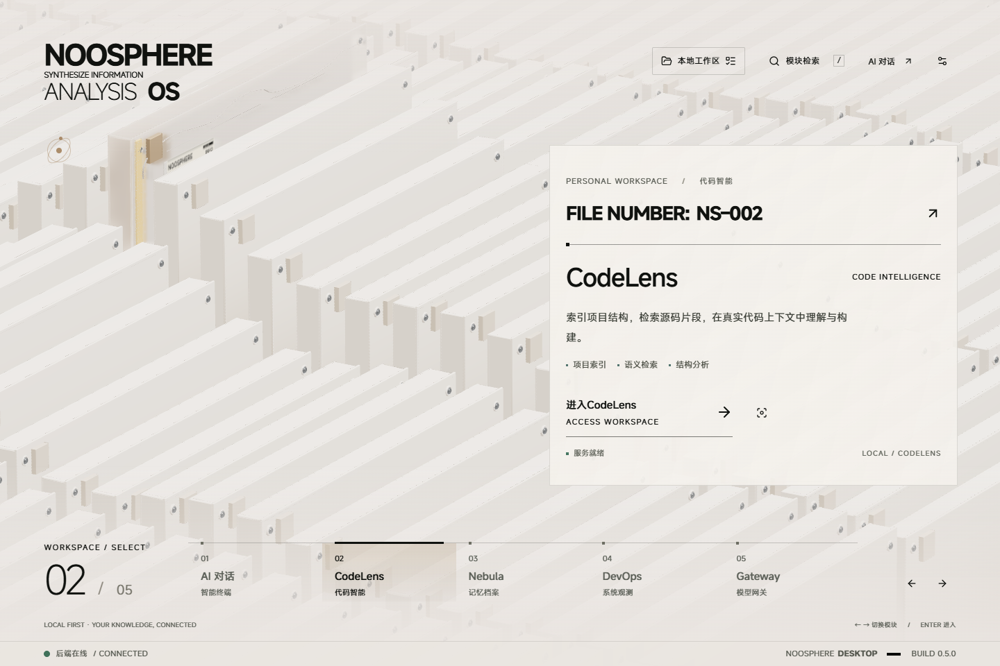
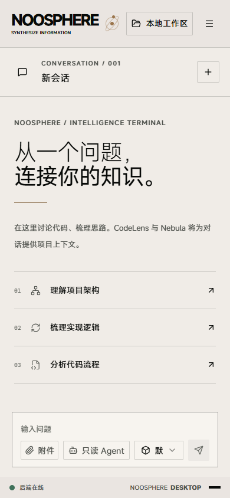

# Noosphere Desktop

[](https://github.com/2722039978-source/Noosphere/actions/workflows/ci.yml)

本地 AI 桌面工作台，Windows 优先。前端使用 React、TypeScript 和 Vite，桌面壳使用 Tauri 2，Go 后端统一管理 AI Gateway、Nebula、DevOps 和 Python CodeLens 服务。可以在同一工作区中进行 AI 对话、代码检索、记忆检索和系统诊断；模型请求按所选 Provider 配置发送。

[开发指南](docs/DEVELOPMENT.md) · [贡献指南](CONTRIBUTING.md) · [GitHub 协作与 CI](docs/github-workflow.md) · [问题反馈](https://github.com/2722039978-source/Noosphere/issues) · [Pull Requests](https://github.com/2722039978-source/Noosphere/pulls) · [Actions](https://github.com/2722039978-source/Noosphere/actions)

- **项目上下文**：CodeLens 建立代码索引，Nebula 提供记忆检索；[工作区与任务](docs/workspace-runtime.md)管理项目绑定、会话归属和后台任务记录。
- **只读 Agent**：在项目范围内搜索、读取文件、检索已确认记忆和检查系统状态，执行步骤与证据保存在任务中心。用法与预算见[可执行 Agent](docs/executable-agent.md)。
- **逐项审批操作**：开启“操作提案”后，可预览文件修改、固定测试和服务启停，由用户逐项确认执行并查看恢复记录，详见[操作审批与恢复](docs/agent-reviewed-actions.md)。

## 界面示例

以下为本地保留的界面回归截图，展示三维档案工作台和 AI 对话窄屏布局，使用测试数据与模拟后端。当前功能与启动方式以源码及下方文档为准；窄屏示例展示响应式布局。



<details>
<summary>查看窄屏界面示例</summary>



</details>

视觉适配与验证记录见 [RhineLabUI 适配说明](docs/rhinelab-adaptation.md)。

## 首次从源码构建（Windows）

本仓库提供源码。首次克隆不会包含生成的 `release/` 或 `Noosphere.lnk`，需要先完成构建。准备 Node.js 20+（自动测试使用 24）、Go 1.26.5、Rust 1.88+（MSVC 工具链）、Python 3.10+、Microsoft C++ Build Tools（“使用 C++ 的桌面开发”及 Windows 10/11 SDK）和 WebView2 Runtime；详细安装与预检见[开发指南](docs/DEVELOPMENT.md)。在仓库根目录运行：

```powershell
npm --prefix frontend ci
npm --prefix desktop ci
python -m venv .local/venv
.local/venv/Scripts/python.exe -m pip install -r backend/python/codelens/requirements-dev.txt
powershell -NoProfile -ExecutionPolicy Bypass -File scripts/preflight.ps1 -RequireDesktop
powershell -NoProfile -ExecutionPolicy Bypass -File scripts/build.ps1
```

完整构建成功后生成 `release/Noosphere.exe`。开发时需要热更新，可使用下方[开发](#开发)章节中的 `scripts/dev.ps1`。增加 `-BundleNsis` 可在本机生成安装包；不带该选项时仅更新便携版，旧安装包会被归档。构建记录和校验值位于 `release/build-info.json`；本机构建产物与 GitHub Release 的公开发布分别管理。

## 已构建后的 Windows 桌面启动

本机已完成完整构建后，双击 `Start-Noosphere.cmd` 或 `release/Noosphere.exe`。应用直接加载内置界面并管理本地后端，无需启动 Vite 或打开浏览器。首次默认进入三维档案工作台，可从五个真实模块入口进入业务；设置中的“工作台体验”可以调整默认入口、画质和启动过渡。

双击 `Create-Shortcuts.cmd` 可在项目目录和 Windows 桌面生成 `Noosphere.lnk`，之后可通过快捷方式启动。移动整个项目目录后，再运行一次来更新快捷方式目标。便携版需要保留 `release` 内的 `bin`、`codelens-python` 等资源。CodeLens 仍需要 Python 依赖：优先使用配置中的明确 Python 路径；默认模式会查找应用或项目的 `.venv`、`.local/venv`，然后尝试系统 Python。上述首次构建步骤创建的 `.local/venv` 不包含在单独的 `release` 文件夹中。

聊天输入栏可开启“只读 Agent”；DevOps 也提供任务入口，任务支持取消和重开查看。已有验证记录见[方案三验证记录](docs/EXECUTABLE_AGENT_VERIFICATION.md)和[第二阶段交付验证](docs/AGENT_ACTIONS_VERIFICATION.md)，记录中的本机结果不代表当前 GitHub CI 或安装包发布状态。

## 子系统

| 子系统 | 技术栈 | 职责 |
|--------|--------|------|
| AI Gateway | Go | 多 Provider LLM 网关（OpenAI / DeepSeek / Claude / Gemini / Ollama），流式 SSE、重试、Token 统计、调用日志 |
| Nebula | Go | 记忆引擎：LSM-Tree + HNSW 向量索引 + BM25 + RRF 混合检索 |
| DevOps Agent | Go | Windows 指标采集、运维工具、Agent Loop、AI 诊断 |
| CodeLens | Python (FastAPI) | Tree-sitter AST 代码分析（Go/Python/JS/TS 等），Go 适配器管理子进程并反向代理 |

## 目录结构

```
Noosphere/
├── frontend/                 # 前端 (React + Vite + TypeScript)
│   ├── src/
│   ├── index.html
│   ├── package.json
│   └── vite.config.ts
│
├── backend/                  # 后端 (Go)
│   ├── cmd/
│   │   └── server/
│   │       └── main.go
│   ├── internal/
│   │   ├── gateway/          # AI Gateway
│   │   ├── nebula/           # 记忆系统
│   │   ├── devops/           # 运维系统
│   │   └── codelens/         # 代码分析
│   ├── python/
│   │   └── codelens/         # CodeLens Python + FastAPI
│   ├── configs/
│   │   └── config.yaml
│   ├── go.mod
│   └── go.sum
│
├── desktop/                  # Tauri 桌面壳
│   ├── src-tauri/
│   └── package.json
│
├── scripts/                  # 启动/构建脚本
│   ├── dev.ps1
│   └── build.ps1
│
├── release/                  # 分发目录（仅打包产物，构建后生成）
├── docs/                     # 架构与历史文档
├── setup.bat                 # CodeLens Python 依赖安装
├── VERSION                   # 版本号唯一来源
├── .gitignore
├── README.md
└── LICENSE
```

## 开发

日常打开方式：完整构建成功后，双击项目根目录 `Start-Noosphere.cmd`，或直接打开 `release/Noosphere.exe`。启动器使用自身所在目录定位程序，桌面程序使用绝对路径定位后端；不要求先打开终端或切换工作目录。

**最新加固记录（2026-09-28）**：本轮补齐项目级代码检索、结构化只读诊断、双层本地凭证、聊天 IndexedDB 迁移与备份，并修复索引和写入恢复问题。实际测试与发布状态见 [本轮交付记录](docs/HARDENING_2026-09-27.md)；[启动修复记录](docs/STARTUP_RELIABILITY.md) 保留为历史记录，不代表当前构建状态。

前置要求：Node.js 20+、Go 1.26.5（go.mod）、Rust 1.88+（MSVC 工具链）、Microsoft C++ Build Tools（包含 Windows 10/11 SDK）和 WebView2 Runtime。前端自动测试使用 Node.js 24。安装和预检见 [开发指南](docs/DEVELOPMENT.md)。

2026-09-09：已接入 RhineLabUI 档案式界面，并完成请求取消、流式协议和持久化优化。实现范围、验证命令与限制见 [界面与流式稳定性记录](docs/RHINE_UI_STREAMING.md)。

```powershell
# 首次安装前端依赖和项目内 Tauri CLI
npm --prefix frontend ci
npm --prefix desktop ci

# 一键启动：构建后端、暂存资源、启动 Vite，再运行桌面开发程序
powershell -ExecutionPolicy Bypass -File scripts\dev.ps1

# 已有构建产物时跳过构建，直接启动
powershell -ExecutionPolicy Bypass -File scripts\dev.ps1 -SkipBuild
```

后端独立开发需先设置临时 `NOOSPHERE_BACKEND_TOKEN`，调用者使用同一 bearer token（监听 `127.0.0.1:8080`）；完整示例见开发指南。桌面模式自动管理凭证。

## 构建与分发

```powershell
# 全链路：Go 后端 → 前端 → Tauri 壳 → 组装 release/
powershell -ExecutionPolicy Bypass -File scripts\build.ps1

# 完整生成便携程序和 NSIS 安装包（使用项目内 Tauri CLI）
powershell -ExecutionPolicy Bypass -File scripts\build.ps1 -BundleNsis

# 仅更新开发用后端和前端产物，release/ 完全不变
powershell -ExecutionPolicy Bypass -File scripts\build.ps1 -SkipTauri
```

完整构建成功后，`release/` 包含程序、运行资源及本地数据。默认不生成安装包；只有 `-BundleNsis` 成功后才将本次新安装包写入本地分发目录。旧程序及旧安装包会保存在 `release/legacy/`。已有 `config.yaml`、`models.yaml`、`data/`、`logs/` 不会被构建覆盖。

```
release/
├── Noosphere.exe             # Tauri 主程序
├── bin/
│   └── noosphere-backend.exe # Go 后端 sidecar
├── config.yaml               # 运行配置
├── config.defaults.yaml      # 首次启动使用的默认配置模板
├── models.yaml               # 模型配置（含加密 API Key，不入库）
├── codelens-python/          # CodeLens Python 服务
├── setup.bat                 # 首次运行安装 Python 依赖
└── Noosphere Desktop_*_x64-setup.exe   # NSIS 安装包（可选产物）
```

首次运行前，若需使用 CodeLens，请运行 `release\setup.bat` 安装 Python 依赖。

便携程序的数据保存在其 `config.yaml` 所在目录。安装版将首次运行配置、模型和数据放到 `%LOCALAPPDATA%\com.noosphere.desktop`，程序资源留在安装目录。可以在设置页查看实际数据目录；如需隔离测试，可用绝对路径环境变量 `NOOSPHERE_DATA_DIR` 指定另一目录。安装包不携带本机模型配置。

## 首次 CodeLens 依赖安装

CodeLens 依赖系统 Python 3.10+（fastapi / uvicorn / pydantic / tree-sitter）：

```powershell
setup.bat
```

## 文档

- [全栈架构](docs/ARCHITECTURE.md)
- [API 参考](docs/API.md)
- [开发指南](docs/DEVELOPMENT.md)
- [贡献指南](CONTRIBUTING.md)
- [GitHub 协作与 CI 范围](docs/github-workflow.md)
- [工作区与任务](docs/workspace-runtime.md)
- [可执行的只读 Agent](docs/executable-agent.md)
- [操作审批与恢复](docs/agent-reviewed-actions.md)
- [会话全文搜索与优化方案](docs/CHAT_SEARCH_PLAN.md)
- [历史演进](docs/HISTORY.md)
- [Word 版架构说明](docs/Noosphere-Architecture.docx)：便于评审和归档

## 参与协作

在 [Issues](https://github.com/2722039978-source/Noosphere/issues) 提交可复现的问题或具体需求，在 [Pull Requests](https://github.com/2722039978-source/Noosphere/pulls) 讨论代码修改，在 [Actions](https://github.com/2722039978-source/Noosphere/actions) 查看对应提交的自动检查结果。提交前的环境准备、验证命令和本机数据保护要求见[贡献指南](CONTRIBUTING.md)；各入口的用途和 CI 边界见[GitHub 协作与 CI](docs/github-workflow.md)。

## License

见 [LICENSE](LICENSE)。
