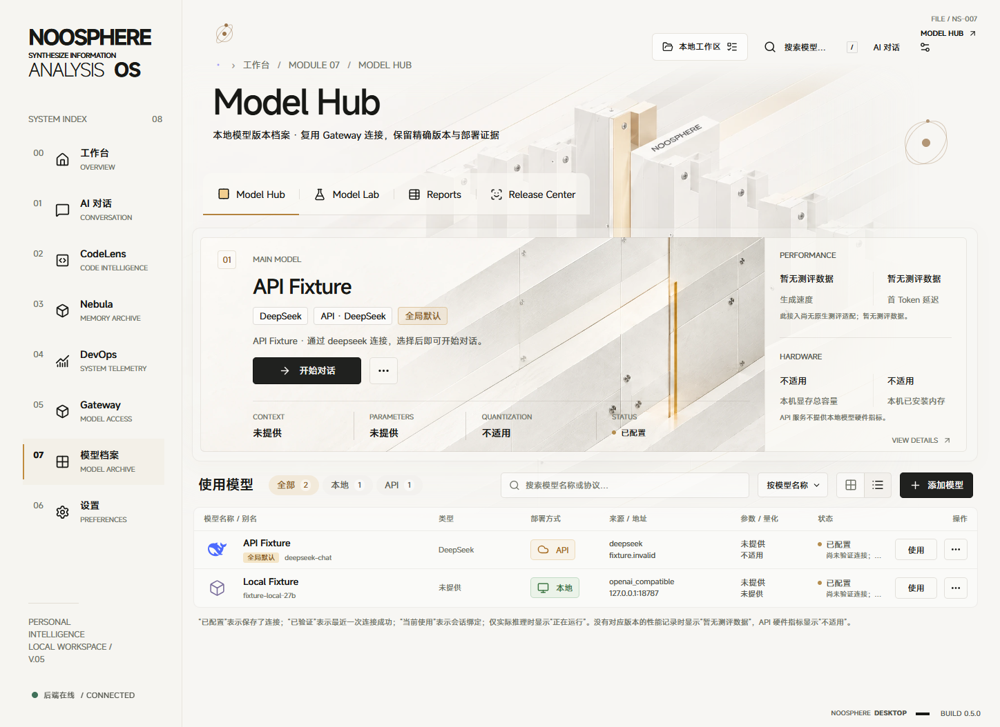
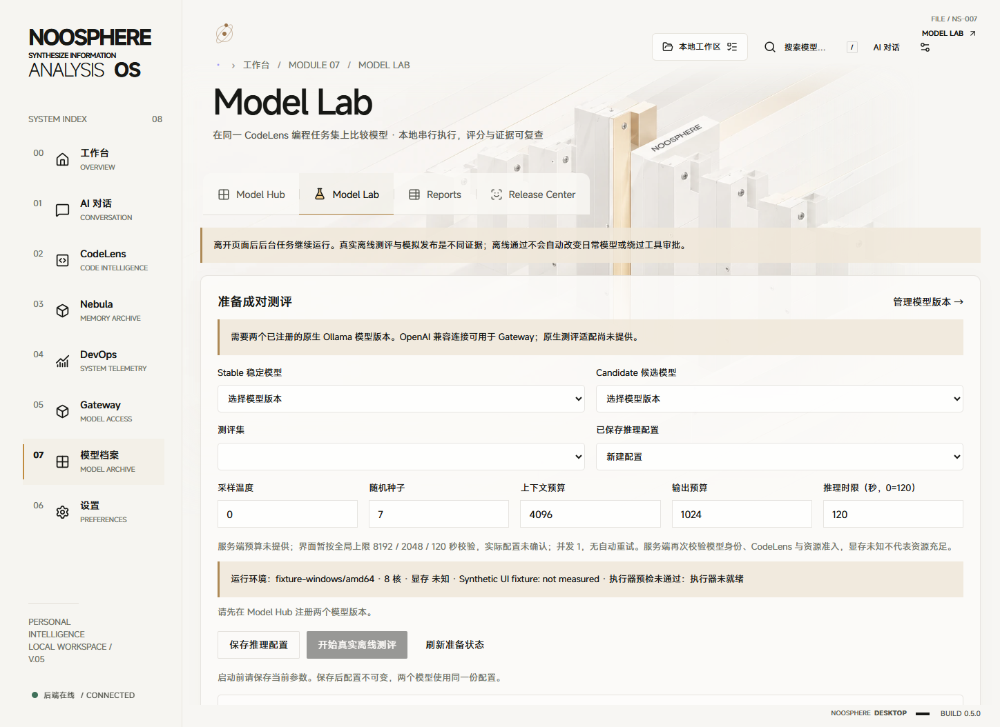

# Noosphere

**在 Windows 桌面上管理项目对话、分析代码，并比较本地模型的表现。**

[](https://github.com/2722039978-source/Noosphere/actions/workflows/ci.yml)

打开最近使用的项目与会话，让 Agent 通过 CodeLens 查找源码依据，使用 REA 查看可执行文件信息。在 Model Hub 接入模型，在 Model Lab 保存版本、运行 Go 任务测评，并从报告查看结果、失败案例与性能数据。点击侧栏顶部的 Noosphere 标识可以进入三维动效主页。

## 功能分区

Noosphere 将日常使用划分为 **AI 对话、CodeLens、Nebula、DevOps、模型** 五个工作区；模型工作区进一步连接 Model Hub、Model Lab、任务集档案、测评报告与 Release Center。各模块围绕项目上下文协作，也可以从对应页面单独使用。

### AI 对话：围绕项目继续工作

- **项目与会话管理**：按工作区组织对话，回到最近使用的项目与会话，通过会话检索找回之前的讨论。
- **流式回答与模型选择**：接收流式输出；模型选择按当前会话绑定、工作区默认、全局默认的顺序生效，已有会话保留自己的模型绑定。
- **带来源的项目上下文**：将 CodeLens 的代码片段、已确认的长期记忆和产物分析记录用于对话，在回答旁查看引用与来源信息。
- **Agent 任务与操作预览**：Agent 可以在项目范围内列出、搜索和读取源码，检索上下文、追踪静态关系，并保留执行步骤与证据。文件修改、受支持的测试和服务操作以提案形式交由用户逐项确认。
- **对话备份**：设置页提供会话备份导出与导入；导入合并时保留已有同 ID 会话，避免静默覆盖本地记录。

适合用来继续项目讨论、定位实现位置，或让 Agent 先收集依据，再决定是否执行变更。Agent 有调用次数与执行时间限制，并非无限制的自主终端。

### CodeLens：代码索引、检索与来源追踪

CodeLens 由 Python 分析服务与 Go 接入层共同提供能力，使用 Tree-sitter 提取源码定义、导入和静态关系。

- **项目索引与代码检索**：把项目源码整理为可检索片段，供代码工作台、对话与 Agent 使用。
- **结构分析**：查看代码实体与静态关系，按符号或文件路径查找相关定义。
- **可核对的证据**：保留文件路径、行号和 SHA-256，读取引用时核对来源版本；源码变化后需要重新索引。
- **REA 产物分析**：读取项目内可执行产物的 PE 导入表与 Go 构建信息，保存原始记录、摘要及文件哈希，供后续引用和复查。

静态调用候选没有经过编译器类型检查，不能替代完整的类型分析或运行时调试。当前 REA 接入也不等于包含其全部逆向分析工具。

### Nebula：长期记忆与资料召回

Nebula 用于保存与检索本机资料，并将可用的项目知识接回对话。

- **记忆会话**：创建记忆会话、存储内容、搜索历史记录并查看元数据。
- **混合检索**：检索引擎包含 BM25 文本检索与向量检索，通过 RRF 合并结果；实际语义检索能力取决于嵌入服务配置。
- **项目知识整理**：将约定、决策、偏好和解决方案保存为工作区记忆，区分待确认、已确认及被替代等状态。
- **有效性检查**：记录来源、修订版本与可选到期时间，向对话提供上下文时排除未确认、过期或来源已变化的项目记忆。

历史记忆会话与经过整理的项目知识是不同用途的记录。检索命中只是参考依据，仍应结合当前源码和工具结果判断。

### DevOps：本机资源观测与诊断

- **资源面板**：查看 CPU、内存、磁盘和进程数量，支持暂停自动采样与手动刷新。
- **模块状态**：查看后端模块健康状态，区分服务不可用与正在等待数据。
- **诊断工具**：结合进程、连接、服务状态等工具信息开展系统诊断，查看工具调用与结果。
- **项目 Agent**：在项目上下文中调查问题；受支持的服务启动、停止等变更可通过操作提案审核。

该模块面向本机环境排查，不应当作已完成生产验证的无人值守运维平台。

### Model Hub：模型连接与能力档案

Model Hub 集中管理本机模型服务和远程 API 连接，让“可以聊天”“可以调用工具”“可以原生测评”分别可见。

- **连接管理**：添加、编辑和测试模型配置，查看模型版本与连接状态。
- **多 Provider 对话**：Gateway 提供 Ollama、OpenAI-compatible、OpenAI、DeepSeek、Anthropic / Claude、Gemini 等适配。
- **能力分开展示**：分别展示对话、Agent 工具与原生测评能力及验证状态，避免把连接成功误认为所有功能均可用。
- **衔接测评**：对满足条件的本机模型发现并登记版本，继续进入 Model Lab。

结构化 Agent 工具目前适配 DeepSeek、OpenAI、OpenAI-compatible 和 Ollama；具体模型仍需实际验证。原生测评适配本机 Ollama 与满足身份核验要求的本机 llama.cpp，不是所有 API 连接都能进入同一测评流程。

### Model Lab：可追溯的本机模型测评

Model Lab 围绕“模型版本、任务集、推理参数、运行环境”组织实验，保存结果供复查。

- **版本与参数记录**：登记模型版本并保存推理配置，让报告对应到具体实验条件。
- **运行前准备检查**：检查模型服务、资源预算、CodeLens 和 Go / WASI 执行环境等条件，呈现无法启动的原因。
- **基线与双版本比较**：同一版本可以独立执行两轮观察重复性，也可以比较两个版本在同一任务条件下的表现。
- **受限 Go 任务执行**：当前工作流为 `codelens.codetask.go.v1`，模型输出经过提取、校验与 Go 编译后，在 wazero / WASI 中运行，再与预期结果比较。
- **任务集档案**：使用内置 Go 任务，或创建、导入自定义 JSON 任务集。保存为不可变版本，编辑生成新版本，历史报告继续引用原来的任务与断言。
- **报告与 HTML 导出**：查看通过情况、逐题变化、失败案例、模型输出和性能数据；导出包含实验条件及证据引用的 HTML 阅读副本。

自定义任务集当前支持每集 1–50 个案例、每例 1–100 组断言，总 JSON 请求不超过 64 KiB，函数签名与评分方式也有限制。结果只描述相应任务和环境下的表现，不构成通用模型排名；缺失的指标会保留未知状态。分享报告前请检查其中的代码、路径与输出。

### Release Center：发布流程模拟

Release Center 使用测评与策略证据组织阶段推进，提供暂停、恢复、拒绝和回滚等流程记录。

**当前是持久化的发布模拟**：不会因为模拟通过而自动替换会话模型，也不代表线上部署或真实流量切换。现有 `simulation-demo-v1` 策略针对内置任务，自定义任务需要另行制定发布标准。

## 推荐使用流程

### 先围绕项目开展对话

1. 在“模型”中添加连接并测试，确认所需的对话或工具能力。
2. 打开项目，在 CodeLens 建立索引，查看关键代码片段与来源。
3. 回到 AI 对话，基于项目上下文提问；需要调查时使用 Agent，并查看任务记录与引用。
4. 对文件、测试或服务操作先检查提案，再逐项确认；将值得保留的项目约定整理为已确认记忆。

### 再比较本机模型表现

1. 在 Model Hub 接入满足原生测评条件的本机模型，登记模型版本。
2. 在 Model Lab 选择版本、任务集与推理配置，先完成准备检查。
3. 运行单版本基线或双版本测评，结合逐题结果、失败类型和有效样本阅读报告。
4. 按需导出 HTML 报告；如要了解策略与阶段推进，可继续使用 Release Center 的模拟流程。

## 截图

Model Hub：模型连接、版本与状态。截图使用独立的示例数据。



<details>
<summary>查看 Model Lab</summary>



</details>

## 下载

- [Windows x64 便携版 v0.5.0（2026-11-03）](https://github.com/2722039978-source/Noosphere/releases/tag/v0.5.0-20261103)：下载页面提供 ZIP 和 SHA-256 校验文件。
- [全部发布版本](https://github.com/2722039978-source/Noosphere/releases)。最新源码可按下方步骤构建。

解压完整便携包后运行其中的 `Noosphere.exe`，保留同目录资源。使用 CodeLens 前安装 Python 3.10+，运行包内的 `setup.bat` 安装依赖。

## 快速开始

从源码构建需要 Windows、PowerShell 7、Node.js 24 与 npm、Go 1.26.5（见 [go.mod](backend/go.mod)）、Rust 1.88+ MSVC 工具链、Microsoft C++ Build Tools 的“使用 C++ 的桌面开发”组件与 Windows SDK，以及 Python 3.10+、WebView2 Runtime。

```powershell
git clone https://github.com/2722039978-source/Noosphere.git
cd Noosphere
npm --prefix frontend ci
npm --prefix desktop ci
python -m venv .local/venv
.local/venv/Scripts/python.exe -m pip install -r backend/python/codelens/requirements.txt
pwsh -NoProfile -ExecutionPolicy Bypass -File scripts/preflight.ps1 -RequireDesktop
pwsh -NoProfile -ExecutionPolicy Bypass -File scripts/build.ps1
```

构建完成后双击 `Start-Noosphere.cmd`。从侧栏“模型”添加并测试模型连接，打开项目后即可开始对话。双击 `Create-Shortcuts.cmd` 可以创建桌面快捷方式；开发模式使用 `scripts/dev.ps1`。

公开核心测试检查 evalrunner 校验、Gateway 模型选择、模型版本比较与报告聚合：

```powershell
pwsh -NoProfile -ExecutionPolicy Bypass -File scripts/check-core.ps1
```

## 模块化架构

桌面端使用 **Tauri 2 / Rust** 承载 **React / TypeScript** 界面，由 Go 后端组织模型调用、工作区、记忆、Agent 和测评服务，Python CodeLens 负责源码解析。下面按实际目录划分，便于阅读和扩展：

| 层级 / 模块 | 主要职责 | 源码位置 |
| --- | --- | --- |
| 前端工作区 | 页面路由、对话、代码、记忆、诊断与模型工程界面 | [frontend/src/app](frontend/src/app)、[frontend/src/features](frontend/src/features) |
| 桌面运行层 | 原生窗口、运行组件管理、本地认证与命令桥接 | [desktop/src-tauri/src](desktop/src-tauri/src) |
| Go 服务入口 | 服务启动、生命周期、路由与后台任务装配 | [backend/cmd/server](backend/cmd/server) |
| Gateway | Provider 适配、流式对话、模型选择与能力检查 | [backend/internal/gateway](backend/internal/gateway) |
| 工作区与 Agent | 项目状态、会话模型绑定、受限工具与操作提案 | [workspaces](backend/internal/workspaces)、[agent](backend/internal/agent) |
| CodeLens | 项目索引、静态来源追踪、Python 服务桥接与 REA 接入 | [Go 接入层](backend/internal/codelens)、[Python 分析服务](backend/python/codelens) |
| Nebula 与 Knowledge | 记忆存储、文本 / 向量检索、项目知识与引用有效性检查 | [nebula](backend/internal/nebula)、[knowledge](backend/internal/knowledge) |
| DevOps 与硬件采集 | 系统指标、诊断工具、主机环境与硬件信息 | [devops](backend/internal/devops)、[hostinfo](backend/internal/hostinfo) |
| 模型工程 | 版本和实验存储、任务集、测评调度、Go / WASI 执行及发布模拟 | [modellab](backend/internal/modellab)、[modelstore](backend/internal/modelstore)、[evalrunner](backend/internal/evalrunner)、[modelops](backend/internal/modelops) |
| 构建与检查 | 环境预检、开发启动、便携包构建、快捷方式与核心测试 | [scripts](scripts)、[CI](.github/workflows/ci.yml) |

前端模块入口定义在 [modules.ts](frontend/src/app/modules.ts)，页面映射见 [routes.tsx](frontend/src/app/routes.tsx)。这里的模块化指代码与职责划分，不表示每个模块都是可独立安装的插件。

## 数据与使用边界

- **Windows 优先、持续开发中**：界面、接口和数据结构仍可能变化，升级前请备份重要配置、对话与实验数据。
- **本地工作台不等于全程离线**：使用远程 Provider 时，对话、附件与提供给模型的项目上下文会发送到对应服务；源码和便携包不附带模型权重。
- **数据目录可查看**：实际目录以设置页显示为准；绝对路径环境变量 `NOOSPHERE_DATA_DIR` 可指定独立数据目录。
- **凭证与导出要分开保管**：模型凭证通过界面管理，不要写入公开示例或 Issue。报告和备份可能包含私人项目内容。
- **验证范围有限**：公开 CI 包含前端构建、Windows 核心测试与 Go 构建 / vet、Python 语法检查；本机模型、具体硬件与原生窗口交互仍需在对应环境验证。

完整的模型适配、任务格式、指标解释、Agent 限制和第三方资源说明见 [LIMITATIONS.md](LIMITATIONS.md)。

## 链接

- [当前边界、数据目录与第三方资源](LIMITATIONS.md)
- [问题反馈](https://github.com/2722039978-source/Noosphere/issues) · [Pull Requests](https://github.com/2722039978-source/Noosphere/pulls) · [CI 检查](https://github.com/2722039978-source/Noosphere/actions)
- [MIT License](LICENSE) · [设计来源与致谢](LIMITATIONS.md#设计来源与第三方资源)
- [RhineLabUI](https://github.com/LBEILC/RhineLabUI) · [REA](https://github.com/morluto/rea)
