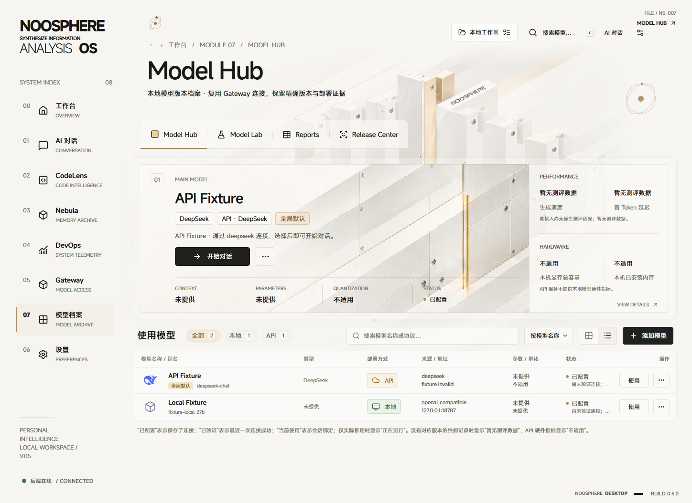
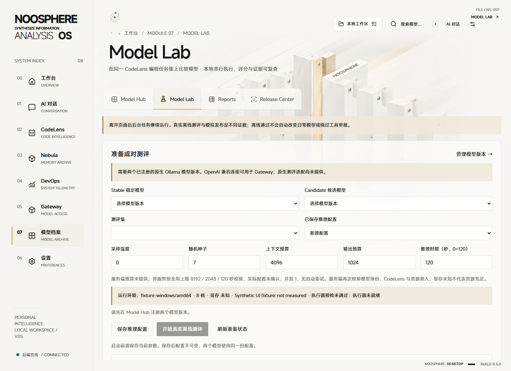

# Noosphere

**面向个人本地模型测评、分析与 Agent 工作流探索的桌面实验工作台。**

[](https://github.com/2722039978-source/Noosphere/actions/workflows/ci.yml)

Noosphere 尝试把模型接入、版本记录、任务测评、结果分析，以及带项目上下文的 Agent 使用过程放进同一个本地工作区。它更关心一个具体问题：**在自己的机器、项目和任务条件下，某个模型是否适合自己，换一个版本后究竟改善了什么，又付出了什么代价？**

> 项目目前尚未完全成熟，仅作为个人思路尝试与持续开发中的实验。界面、数据结构、模型适配和测评流程仍在调整。现有结果只描述具体版本、任务集、参数与运行环境下的观察，不代表通用模型排名，也不构成生产可用性承诺。

[项目定位](#项目定位) · [模型测评与分析](#模型测评与分析) · [Agent 与项目上下文](#agent-与项目上下文) · [当前边界](#当前边界) · [从源码运行](#从源码运行windows) · [设计来源与致谢](#设计来源与致谢)

## 项目定位

这个项目起于个人使用本地模型时的几个实际需求：

- 记录模型的真实身份与版本，区分模型厂商、模型系列、接入 Provider 和部署方式。
- 在尽量一致的任务与推理参数下比较两个本地模型，保留失败案例和可复查的结果。
- 区分回答质量、生成速度、加载开销和资源条件，避免仅凭一个跑分或一段演示选择模型。
- 将模型放进带代码检索、记忆检索和工具调用的 Agent 流程里，观察它在自己项目中的实际表现。
- 保留每次实验的上下文、过程和限制，方便之后复查，而不是只留下一个“通过”或“失败”。

当前以 **Windows 本地桌面使用**为主。模型可以运行在本机服务中，也可以通过 API 接入；“本地工作台”并不表示所有请求都离线。使用远程 Provider 时，提交给模型的对话和上下文会发送到所配置的服务。

## 模型测评与分析

模型档案包含四个相互衔接的页面：

| 页面 | 当前用途 |
| --- | --- |
| **Model Hub** | 管理模型接入与身份信息，查看配置和连接状态，选择当前会话模型，并为支持的模型注册精确版本。 |
| **Model Lab** | 选择 Stable / Candidate 两个模型版本、任务集和已保存的推理配置，准备并执行本地成对测评。 |
| **Reports** | 查看持久化测评结果、任务分类、失败案例、指标来源、缺失原因和比较分析。 |
| **Release Center** | 根据已有报告探索候选模型的门禁判断、分配与回滚流程；目前属于发布模拟与回放。 |

一条典型的使用路径是：

1. 在 Gateway / Model Hub 配置本地模型服务，确认连接并读取可用的模型身份。
2. 对当前支持原生测评的模型，确认发现结果并注册版本，保留 digest、配置与元数据等身份依据。
3. 在工作区准备 CodeLens 编程任务集，选择两个模型版本并保存推理参数。
4. 通过执行器、模型身份、CodeLens 与资源预检后，运行串行成对测评，观察进度；任务记录支持离开页面后重开。
5. 在 Reports 中结合正确性、失败类型、耗时和实际可获得的指标做判断，再回到真实对话或 Agent 场景继续验证。

### 当前测评范围

- **真实原生测评目前仅适配 Ollama**。OpenAI-compatible 等接入可以用于对话和 Agent，但不能因此被当作已经具备精确版本、驻留校验和原生测评能力。
- 当前实现的受限编程工作流为 `codelens.codetask.go.v1`，主要面向约束明确的 Go 函数任务。模型输出经过提取和校验后，由可信 Go 工具链编译，在 WASI 执行器中运行并与预期结果比较。
- 保存的模型版本、推理配置、任务集与执行记录共同描述一次实验。中断、取消、重试和恢复应保留独立过程与结果，不能把未完成任务计作成功。
- 测评受本机算力、内存、模型服务和工具链条件约束。模型能通过聊天连接，不等于一定能通过本地测评的资源准入。

### 如何理解结果

正确性评分、失败原因和性能指标需要一起看。可获得的性能信息包括宿主侧耗时，以及模型引擎实际返回的加载、提示处理、生成耗时和 Token 数等；展示生成速率时会使用对应版本的有效记录并说明来源。

**没有测量的项目不补模拟值。** 尚无对应版本记录时显示“暂无测评数据”；API 模型的本地硬件指标显示“不适用”；引擎未报告或当前无法可靠归因的 CPU、内存、显存等信息保留未知原因。不能用总响应耗时推算出未测量的首 Token 延迟，也不能把模型文件大小当作显存占用。

Release Center 当前用于研究发布决策过程，其阶段推进、分配和回滚是**持久化模拟**。模拟通过不会自动替换日常会话模型，也不表示已完成真实线上部署、流量切换或生产灰度验证。

## Agent 与项目上下文

Agent 是本项目探索模型实用性的另一部分：除了单次回答，还要观察模型能否在有限预算和工具范围内，找到证据、理解项目并解释结论。

- **工作区与会话**：绑定项目目录，保存会话归属、后台任务和运行记录。
- **CodeLens**：由本地 Python 服务进行代码索引、AST 分析与检索，为对话和 Agent 提供项目上下文。
- **Nebula**：提供记忆保存与检索能力。可用性和检索质量取决于所配置的嵌入服务与实际资料。
- **只读 Agent**：在允许的项目范围内搜索和读取文件、检索已确认记忆、检查系统状态，保留工具步骤与证据。
- **操作提案与审批**：需要修改文件、运行受支持的固定测试或启停服务时，先展示提案，由用户逐项确认，并保留执行与恢复记录。
- **DevOps**：查看本机状态、诊断信息和任务执行过程，辅助理解模型与工具运行时的环境条件。

Model Lab 的成对任务测评与这些真实 Agent 使用流程相互补充。当前没有将有限的编程任务得分等同于完整 Agent 能力，也尚未覆盖所有工具组合与复杂项目任务。

## 模型接入与状态

Gateway 统一处理已有的 Ollama、OpenAI-compatible、OpenAI、DeepSeek、Anthropic / Claude、Gemini 等 Provider 接入。协议实现存在不代表所有服务商、模型版本和扩展能力都已验证；具体能力以相应适配器和实际连接结果为准。

模型选择有三个不同作用域：

- **当前会话模型**：Model Hub 的“使用”针对当前目标会话，经后端校验并确认后生效；切换失败会保留原绑定并显示原因。
- **工作区默认模型**：单独设置，用于该工作区后续未显式指定模型的会话。
- **全局默认模型**：单独设置，作为没有更具体绑定时的默认选择。

已有会话绑定与新会话默认选择分开处理。Agent 工具执行期间不静默改用另一个模型。

界面区分“已配置”“已验证”“连接失败”“已禁用”“当前使用”“默认模型”和“正在运行”。保存接入配置不代表模型正在推理；当前会话正在使用的模型也不一定是全局默认模型。

## 界面

一级导航为工作台、AI 对话、CodeLens、Nebula、DevOps、Gateway、模型档案和设置；模型档案内部再进入 Hub、Lab、Reports 与 Release Center。

默认 Model Hub 与模型档案页面使用统一的白色建筑档案背景、香槟金强调色、黑白灰排版和细线分区。背景采用本地静态美术，页面切换时共享保留；独立三维档案入口按需加载。模型卡片与列表中的名称、按钮、状态和指标均由真实界面组件与数据驱动。

以下为隔离测试数据下的界面渲染，仅展示布局与交互外观，图中模型名称与记录不代表使用者的实际配置或模型表现。



<details>
<summary>查看 Model Lab 界面</summary>



</details>

## 当前边界

本项目仍处于个人实验阶段，尤其需要注意：

- 原生测评适配、任务类型与操作系统覆盖范围有限，尚未形成通用的多后端评测平台。
- 小型任务集、固定种子和受限执行环境只能提供局部证据，不能替代真实项目长期使用。
- API 服务能力、模型上下文、量化方式和本机资源应按实际配置读取，不能照搬界面示例。
- 硬件信息可能无法采集或无法归因到单个模型；未知值不会被当作资源足够。
- 发布中心的模拟流程与真实部署分开；Agent 的操作范围也受现有工具与审批机制限制。
- 浏览器中的合成数据测试、真实模型验证与原生桌面人工验收是不同层次的证据。测试脚本存在不代表每项在当前机器上都已通过。
- 数据结构和接口仍可能变化。升级或迁移前应自行备份重要配置与实验数据。

欢迎用可复现的问题、具体任务与失败案例帮助改进，而不是把它视为已经成熟的生产工具。

## 技术结构

| 层级 | 实现与职责 |
| --- | --- |
| 桌面壳 | Tauri 2 / Rust：原生窗口、IPC、本地服务生命周期与桌面资源管理。 |
| 前端 | React / TypeScript / Vite：模型档案、对话、Agent 任务和分析界面。 |
| 本地后端 | Go：Gateway、工作区、模型版本与测评记录、任务调度、Nebula 与 DevOps。 |
| 模型工程 | `modelstore`、`modellab`、`modelops`：版本与证据持久化、测评、报告和发布模拟。 |
| 测评执行器 | Go 工具链与 wazero / WASI：约束编程输出的编译与用例执行。 |
| 代码上下文 | Python / FastAPI / Tree-sitter：CodeLens 代码索引、分析与检索。 |

```text
Noosphere/
├── frontend/                  # 界面、模型档案及前端测试
├── backend/
│   ├── cmd/server/            # 本地 API 与任务接入
│   ├── internal/              # Gateway、模型工程、工作区等模块
│   ├── python/codelens/       # Python 代码分析服务
│   ├── configs/config.yaml    # 可分发的默认配置
│   └── models.yaml.example    # 不含真实凭证的接入示例
├── desktop/                   # Tauri 桌面工程
├── scripts/                   # 预检、开发、构建和快捷方式脚本
├── docs/screenshots/          # README 使用的公开界面示例
├── .github/workflows/         # 自动检查配置
├── VERSION
├── README.md
└── LICENSE
```

仓库保存源码、必要资源和本介绍。个人开发记录、其他 Markdown、本机模型配置、凭证、模型权重、运行数据、日志及构建产物不属于公开源码。

## 从源码运行（Windows）

准备以下环境：

- Node.js 20+ 与 npm；仓库自动检查使用 Node.js 24。
- Go 1.26.5，以 `backend/go.mod` 为准；真实编程测评也需要可用的可信 Go 工具链。
- Rust 1.88+ 的 MSVC 工具链、Microsoft C++ Build Tools、“使用 C++ 的桌面开发”和 Windows 10/11 SDK。
- Python 3.10+、WebView2 Runtime。
- 如需本地模型，在本机另行安装并运行模型服务，准备适合硬件条件的模型；源码不附带模型权重。

```powershell
git clone https://github.com/2722039978-source/Noosphere.git
cd Noosphere

npm --prefix frontend ci
npm --prefix desktop ci
python -m venv .local/venv
.local/venv/Scripts/python.exe -m pip install -r backend/python/codelens/requirements-dev.txt

powershell -NoProfile -ExecutionPolicy Bypass -File scripts/preflight.ps1 -RequireDesktop
powershell -NoProfile -ExecutionPolicy Bypass -File scripts/build.ps1
```

完整构建后，双击 `Start-Noosphere.cmd` 或 `release/Noosphere.exe`。程序加载内置界面并管理本地后端。首次克隆不会包含 `release/`、快捷方式、本机 Python 虚拟环境或用户配置。

双击 `Create-Shortcuts.cmd` 可以生成项目和桌面快捷方式。移动项目后重新生成快捷方式即可。

首次使用建议先完成：

1. 创建工作区，按需绑定项目目录。
2. 在 Gateway / Model Hub 添加本地模型或 API 接入，填写实际地址与模型 ID，再测试连接。
3. 通过界面选择当前会话模型；按需要单独设置工作区或全局默认。
4. 使用 CodeLens 前确认 Python 依赖和项目索引状态；使用真实 Model Lab 测评前确认其原生适配与执行器准备状态。

### 开发与检查

```powershell
# 启动本地后端、前端热更新和桌面开发程序
powershell -NoProfile -ExecutionPolicy Bypass -File scripts/dev.ps1

# 前端单元测试与生产构建
npm --prefix frontend test
npm --prefix frontend run build

# 后端测试
Push-Location backend
go test ./...
Pop-Location

# Python CodeLens 测试
.local/venv/Scripts/python.exe -m unittest discover -s backend/python/codelens -p "test_*.py" -v
```

`frontend/tests/` 还包含基于隔离数据的交互与构建资源检查入口。原生窗口、快捷方式启动、真实 Provider 和本机硬件体验需要另外验证；运行界面测试不代表已完成这些检查。

### 构建与数据目录

```powershell
# 构建便携版
powershell -NoProfile -ExecutionPolicy Bypass -File scripts/build.ps1

# 同时生成本机 NSIS 安装包
powershell -NoProfile -ExecutionPolicy Bypass -File scripts/build.ps1 -BundleNsis
```

`release/` 中的程序需要连同 `bin/`、`codelens-python/` 等资源一起保留。Python 运行环境与依赖仍需按实际部署准备；可以运行分发目录中的 `setup.bat` 安装 CodeLens 依赖。

便携版数据位于运行配置所在目录；安装版通常使用 `%LOCALAPPDATA%\com.noosphere.desktop`。可在设置中查看实际目录，也可通过绝对路径环境变量 `NOOSPHERE_DATA_DIR` 指定独立数据目录。构建记录位于本机 `release/build-info.json`。

模型配置与凭证通过界面管理。Windows 下的凭证保存使用加密存储与系统凭证管理能力；不要将真实密钥写进源码、示例、Issue 或公开日志。导出的实验内容也可能包含项目代码和路径，分享前应自行检查。

## 设计来源与致谢

**Noosphere 的档案式设计语言灵感来源于 [LBEILC/RhineLabUI](https://github.com/LBEILC/RhineLabUI)。** 感谢该项目提供的白色建筑档案、细线排版、材质和交互方向。独立三维档案场景的阵列、盒体模型、材质、运动与灯光也以其实现为基础进行适配；Noosphere 在此基础上围绕个人模型测评、分析和 Agent 工作区组织自己的功能。

RhineLabUI 说明其视觉参考来自《明日方舟》「莱茵生命：访问」相关终端界面；Noosphere 与原作品、RhineLabUI 作者及相关品牌之间没有官方关联或背书关系。模型厂商图标使用本地维护的资源，相关通知与许可证保留在 `frontend/public/model-brands/`；字体声明保留在 `frontend/public/fonts/`。模型档案的静态建筑美术按参考方向单独生成。

本项目自有代码使用 [MIT License](LICENSE)。第三方代码、模型、字体、图标及其他素材的权利与许可仍以各自声明为准；设计致谢不改变其授权条件。

## 反馈与协作

可以在 [Issues](https://github.com/2722039978-source/Noosphere/issues) 提交使用问题、测评失败案例或适配建议，通过 [Pull Requests](https://github.com/2722039978-source/Noosphere/pulls) 讨论修改，在 [Actions](https://github.com/2722039978-source/Noosphere/actions) 查看对应提交的自动检查结果。

反馈时请说明操作步骤、相关版本、预期与实际行为；分享记录前移除凭证、个人路径、私人代码和其他不便公开的信息。项目仍是个人尝试，欢迎一起验证与修正它的思路。
